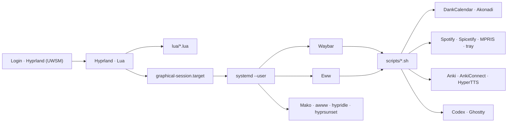

<div align="center">

# Hyprland · openSUSE Tumbleweed

Um desktop Wayland completo, reproduzível e opinativo — configurado em Lua,
com visual Catppuccin Mocha e integrações reais para produtividade, agenda,
agentes locais e estudo.

[](https://get.opensuse.org/tumbleweed/)
[](https://hypr.land/)
[](hyprland.lua)
[](https://catppuccin.com/)
[](scripts/)

</div>

> [!IMPORTANT]
> O bootstrap foi feito especificamente para **openSUSE Tumbleweed**. Ele cria
> backup antes de substituir configurações conhecidas e oferece `--dry-run`
> para revisão prévia.

## O que há aqui

| Área | Componentes e experiência |
|---|---|
| Compositor | Hyprland 0.55+ em Lua, animações, regras e atalhos modulares |
| Sessão | UWSM e serviços `systemd --user` supervisionando os daemons |
| Interface | Waybar, dashboard Eww, Fuzzel, Mako, wlogout e Ghostty |
| Aparência | Catppuccin Mocha, Kvantum, GTK, Papirus e Bibata |
| Agenda | DankCalendar com Google e Outlook; Proton Calendar pela web |
| Música | Spotify com Spicetify, Marketplace, MPRIS e bandeja útil |
| Estudos | Anki, Study Hub, AnkiConnect autenticado e áudio francês |
| Agentes | Codex no Ghostty, com perfis de sandbox e aprovação explícitos |
| Utilitários | screenshots, gravação, clipboard, OSD, VPN, mídia e monitores |

### Destaques

- **Dashboard reativo:** agenda, mídia, áudio, brilho, clipboard, clima,
  telemetria e quick toggles em um único painel Eww.
- **Waybar operacional:** privacidade, gravação, VPN, perfil de energia,
  inibidor de ociosidade e carga diária do Study Hub.
- **Agenda unificada:** Google e Outlook pessoal no DankCalendar, com
  sincronização e lembretes em segundo plano; Proton permanece no navegador.
- **Música personalizável:** Spotify usa o layout Sleek/Catppuccin do
  Spicetify, Marketplace visual, MPRIS e controles completos na bandeja.
- **Study Hub:** 60 notas curadas e 84 cartões sobre Kubernetes, NVIDIA/GPU no
  Kubernetes e francês, sem substituir coleções já existentes.
- **Francês com áudio:** 24 MP3s cacheados, HyperTTS como fallback e um
  diagnóstico silencioso para validar toda a cadeia.
- **Agentes locais controlados:** atalhos para trabalhar nesta configuração,
  na agenda, em projetos escolhidos ou no Anki, sem desabilitar sandbox.
- **Dock/undock resiliente:** o monitor externo é identificado pela descrição,
  e os workspaces acompanham automaticamente a única tela ativa.

## Arquitetura



A configuração canônica é [`hyprland.lua`](hyprland.lua). Os fragmentos
[`conf.d/`](conf.d/) permanecem como referência e caminho de rollback; os
módulos ativos vivem em [`lua/`](lua/).

## Instalação

### 1. Obtenha o repositório

Depois de publicá-lo no GitHub, copie a URL exibida pelo botão **Code**:

```bash
git clone URL_COPIADA_DO_GITHUB ~/hypr-bootstrap
cd ~/hypr-bootstrap
```

Também é possível transferir diretamente a configuração atual:

```bash
rsync -a ~/.config/hypr/ usuario@outro-computador:~/hypr-bootstrap/
```

### 2. Revise o plano

```bash
chmod +x bootstrap-opensuse-tumbleweed.sh
./bootstrap-opensuse-tumbleweed.sh --dry-run
```

### 3. Instale

```bash
./bootstrap-opensuse-tumbleweed.sh \
  --with-extras \
  --wallpaper ~/Pictures/meu-wallpaper.jpg \
  --avatar ~/Pictures/meu-avatar.jpeg
```

O bootstrap:

1. confirma o openSUSE Tumbleweed e instala dependências;
2. instala DankCalendar, Spotify e Anki pelo Flathub quando necessário;
3. baixa ativos visuais fixados por versão e SHA-256;
4. cria backup em `~/.local/state/hypr-bootstrap/backups/`;
5. instala a sessão UWSM, configurações e serviços de usuário;
6. usa um perfil de monitor genérico seguro em hardware diferente;
7. valida Bash, JSON e a configuração do Hyprland.

No primeiro login, escolha **Hyprland (UWSM)** no gerenciador de sessão.

### Opções do bootstrap

| Opção | Efeito |
|---|---|
| `--with-extras` | instala também o inspetor de eventos Wayland `wev` |
| `--same-hardware` | preserva o perfil LG ultrawide + `eDP-1` deste computador |
| `--internal-output eDP-2` | troca o nome esperado do painel interno |
| `--wallpaper ARQUIVO` | instala o wallpaper usado pelo awww |
| `--avatar ARQUIVO` | instala o avatar exibido pelo Eww |
| `--skip-packages` | não executa o zypper |
| `--skip-themes` | não baixa fontes, cursor ou temas |
| `--dry-run` | exibe as ações sem modificar a máquina |

## Monitores e portabilidade

O perfil desta máquina em [`lua/monitors.lua`](lua/monitors.lua) representa um
fluxo de **uma tela ativa por vez**:

- conectado ao dock: LG ultrawide em `3440x1440@85` e painel interno desligado;
- desconectado: `monitor-listener.sh` reativa o painel do notebook;
- workspaces não são presos a um conector, evitando que desapareçam após uma
  troca de `DP-1` para `HDMI-A-1`.

O monitor LG é identificado por
[`desc:`](https://wiki.hypr.land/Configuring/Basics/Monitors/), não pelo nome
instável do conector.
Em outro computador, o bootstrap instala
[`portable/monitors-generic.lua`](portable/monitors-generic.lua), que usa modo
preferencial e posicionamento automático. Use `--same-hardware` apenas em uma
máquina realmente equivalente.

Depois do primeiro login:

```bash
hyprctl monitors
$EDITOR ~/.config/hypr/lua/monitors.lua
hyprctl reload
```

## Atalhos principais

| Atalho | Ação |
|---|---|
| `Super+Return` | abrir Ghostty |
| `Super+D` | abrir Fuzzel |
| `Super+W` | abrir ou fechar o dashboard Eww |
| `Super+O` | abrir a agenda no DankCalendar |
| `Super+M` | abrir o Spotify personalizado |
| `Super+G` | abrir o menu de agentes |
| `Super+Shift+A` | abrir o Study Hub no Anki |
| `Super+Print` | capturar uma região e anotar no Swappy |
| `Super+Alt+R` | iniciar ou parar uma gravação de região |
| `Super+Shift+C` | copiar uma cor com Hyprpicker |
| `Super+Ctrl+M` | configurar monitores com NWG Displays |
| `Super+Ctrl+B` | abrir btop no Ghostty |
| `Super+Escape` | abrir o menu de sessão |

`Print`, `Shift+Print` e `Ctrl+Print` mantêm os fluxos rápidos de screenshot.
As teclas físicas de áudio e brilho atualizam o PipeWire/backlight e exibem o
OSD do wob.

## Agenda

O [DankCalendar](https://github.com/AvengeMedia/dankcalendar) é a
interface principal de agenda. O relógio da Waybar, `Super+O` e o botão
**Agenda** do Eww abrem uma janela flutuante proporcional ao monitor. O
dashboard mostra os próximos compromissos pela API local.

Adicione contas pelo painel **Accounts** ou pelo terminal:

```bash
~/.config/hypr/scripts/dcal.sh account add google
~/.config/hypr/scripts/dcal.sh account add microsoft
```

- Google e Outlook pessoal usam OAuth no navegador;
- Outlook também fica disponível pela web no clique do meio do relógio;
- Proton Calendar abre exclusivamente pela web;
- Merkuro/KOrganizer e Akonadi permanecem como fallbacks.

Tokens ficam no KWallet e não entram no repositório.

## Música

O cliente oficial do Spotify fornece autenticação, biblioteca e reprodução;
o [Spicetify](https://github.com/spicetify/cli) substitui a aparência pelo
**Sleek/Catppuccin** e adiciona o Marketplace para trocar temas, snippets e
extensões visualmente. A versão Flatpak instalada no escopo do usuário torna a
personalização reversível e evita permissões de root. Um Spotify do sistema
pode coexistir sem ser alterado.

`Super+M` e o botão **Spotify** no Eww mostram uma janela Wayland sem barra de
título, centralizada e proporcional ao monitor. O serviço
`spotify-tray.service` publica um ícone vetorial nítido e um menu com faixa e
artista atuais, abrir, play/pause, anterior, próxima, shuffle, repeat e cópia do
link da faixa. O menu controla o MPRIS do cliente; dashboard, `playerctl` e
teclas físicas usam a mesma interface. Um override Flatpak restrito bloqueia
somente o indicador nativo redundante do Spotify, deixando um único ícone na
bandeja sem afetar MPRIS.

O instalador fixa e valida por SHA-256 o Spicetify 2.44.0, o Marketplace 1.0.9
e os dois arquivos do tema Sleek. Atualizações do Spotify podem exigir executar
novamente `~/.config/hypr/scripts/spotify-customize.sh`. Login, biblioteca,
histórico e cache continuam no perfil privado do Flatpak e não entram no
repositório.

Em uma instalação nova, primeiro abra o Spotify, faça login e aguarde pelo
menos 60 segundos; depois execute `spotify-customize.sh`. Esse primeiro uso é
necessário para o Spotify criar os arquivos esperados pelo Spicetify. Em um
perfil já autenticado, o bootstrap aplica a personalização automaticamente.

## Study Hub

O Study Hub integra [Anki](https://apps.ankiweb.net/) à Waybar, ao Eww, ao
Fuzzel e aos agentes:

| Baralho | Notas | Cartões |
|---|---:|---:|
| Kubernetes Core | 18 | 18 |
| NVIDIA GPUs on Kubernetes | 18 | 18 |
| French Essentials | 24 | 48 |
| **Total** | **60** | **84** |

As notas técnicas possuem links para documentação primária. As frases em
francês têm cartões de reconhecimento e produção, com MP3 cacheado na mídia do
Anki. O seed é idempotente e não substitui baralhos importados.

AnkiConnect:

- escuta somente em `127.0.0.1:8765`;
- exige uma chave aleatória com permissão `0600`;
- é instalado de uma release revisada e fixada por SHA-256;
- nunca requer edição direta do SQLite do Anki.

Com o Anki aberto, valide TTS, templates e mídia sem reproduzir áudio:

```bash
~/.config/hypr/scripts/study-tts-check.sh
```

Login, coleção, histórico e mídia pessoal do AnkiWeb não são versionados.

## Agentes locais

`Super+G` inicia o Codex no Ghostty com perfis para:

- editar esta configuração;
- planejar usando a agenda;
- criar ou revisar flashcards;
- trabalhar em uma pasta escolhida;
- inspecionar o computador em modo somente leitura;
- retomar conversas anteriores.

Perfis editáveis usam `workspace-write` e aprovação `on-request`. Operações em
massa no Anki, mudanças de templates e exclusões exigem confirmação explícita.
No primeiro uso, execute `codex login`.

## Estrutura do repositório

```text
.
├── hyprland.lua                   # entrada canônica do compositor
├── lua/                           # módulos ativos do Hyprland
├── conf.d/                        # configuração legada / rollback
├── scripts/                       # automações do desktop
├── portable/
│   ├── anki/                      # bundle curado do Study Hub
│   ├── eww/                       # dashboard e listeners
│   ├── waybar/                    # barra e estilos
│   ├── systemd/user/              # serviços da sessão
│   └── ...                        # apps, temas e configurações auxiliares
├── assets/                        # instruções para arquivos visuais locais
├── bootstrap-opensuse-tumbleweed.sh
└── SUGESTOES.md                   # histórico das decisões incorporadas
```

## Verificação e diagnóstico

```bash
# Configuração canônica
Hyprland --verify-config --config ~/.config/hypr/hyprland.lua
hyprctl configerrors

# Scripts e dados
bash -n ~/.config/hypr/scripts/*.sh
jq empty ~/.config/hypr/portable/waybar/config.jsonc
jq empty ~/.config/hypr/portable/anki/starter-decks.json

# Serviços principais
systemctl --user status waybar eww mako hypridle

# Reprodução segura
~/.config/hypr/bootstrap-opensuse-tumbleweed.sh --dry-run
```

## Dados deliberadamente não versionados

- tokens OAuth, KWallet e contas de agenda;
- chave local do AnkiConnect;
- login, coleção e mídia pessoal do AnkiWeb;
- login, biblioteca, histórico e cache do Spotify;
- autenticação e histórico do Codex;
- perfis VPN e credenciais;
- wallpaper, avatar e arquivos pessoais;
- binários opcionais como Handy e configurações privadas do smarty-pants.

Para o registro detalhado das melhorias e decisões de segurança, consulte
[`SUGESTOES.md`](SUGESTOES.md).

---

<div align="center">

Feito para um desktop pessoal que precisa ser bonito, rápido, estudável e
reproduzível — sem transformar credenciais em dotfiles.

</div>
