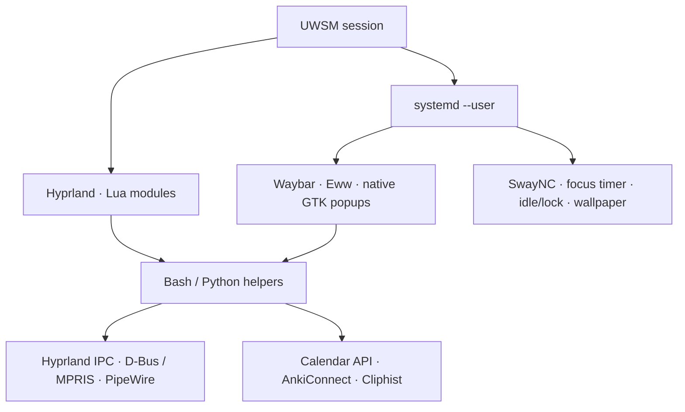

# hypr-configs

**A Lua-configured Wayland desktop with native controls, supervised services, and a portable openSUSE bootstrap.**

[](https://get.opensuse.org/tumbleweed/)
[](https://wiki.hypr.land/)
[](https://catppuccin.com/)
[](LICENSE)

[Install](#getting-started) · [Architecture](#architecture) · [Controls](#keyboard-first-mouse-friendly) · [Customize](#make-it-yours) · [Contribute](#development) · [License](#license)

An opinionated desktop for people who work in terminals and still want the rest
of the interface to feel considered. Catppuccin Mocha ties together the bar,
dashboard, app trays, notifications, terminals and editor. Bash and Python
connect them through the desktop's existing APIs.

## The experience

| Surface | What it does |
|---|---|
| **App trays** | Spotify player with artwork and seeking; Steam's recently played games; a calendar with day selection and upcoming events |
| **Sound** | Output and microphone selection, per-app volume, mic mute, and a passive volume/brightness OSD |
| **Network** | One Wi-Fi picker for either mouse button, with saved networks, password entry, background scanning and connection progress |
| **Notifications & focus** | SwayNC history and DND; 25/50-minute sessions that quiet notifications without overwriting your DND preference |
| **Waybar & Eww** | Rich clock and Anki hover cards, recording/mic indicators, VPN status, and a compact system drawer |
| **Clipboard & scratchpads** | Searchable text/image history; terminal and quick-note windows that launch once and toggle into view |
| **Writing & development** | Ghostty, Helix and Yazi; Markdown navigation, document previews, bibliography picking, and optional Herdr workspaces |
| **App integration** | Coordinated Zen, Obsidian, Starship, Kitty, Alacritty and ZapZap themes; Anki study workflows and calendar sync |

Spotify keeps playing when hidden with `Super+Q`; `Super+M` restores it.
Popup controls support Escape and outside-click dismissal. Audio refreshes read
device state without changing it. Clipboard selection copies the original bytes.

See the [desktop controls guide](docs/desktop-controls.md),
[application integrations](docs/integrations.md), and
[terminal writing workflow](WORKFLOW.md) for the details.

## Architecture



- **Lua is canonical.** [`hyprland.lua`](hyprland.lua) loads the modules in
  [`lua/`](lua/). The old `conf.d/` syntax is kept as a historical fallback.
- **Services own their lifecycle.** Long-running helpers are supervised by
  `systemd --user` and tied to the graphical session. Tray popups use GTK 3,
  GtkLayerShell and StatusNotifier; SwayNC uses GTK 4.
- **Native APIs connect the pieces.** Media controls use MPRIS, audio uses
  PipeWire's PulseAudio interface, and the calendar reads DankCalendar's local API.
  AnkiConnect is restricted to loopback and authenticated with a generated key.
- **Portable settings are explicit.** `portable/` contains deployable app
  configuration. Account credentials, collections, vaults, clipboard history and
  runtime state stay in application data directories.
- **Installation is repeatable, with boundaries.** The bootstrap backs up known
  settings and verifies pinned downloads. Tumbleweed packages and Flatpaks still
  move with their upstream repositories; this is a configured desktop, not a
  locked system image.

## Getting started

**Target:** openSUSE Tumbleweed on x86_64, with the Hyprland Lua configuration API
(0.55+). The current setup has been checked with Hyprland 0.56.2, Waybar 0.15.0
and SwayNC 0.12.6. Other distributions require adapting the package and session setup.

```bash
git clone https://github.com/thbertoldi/hypr-configs.git
cd hypr-configs

# Inspect package installation, backups and deployment before applying them.
./bootstrap-opensuse-tumbleweed.sh --dry-run

# Run as your normal user; the installer invokes sudo where needed.
./bootstrap-opensuse-tumbleweed.sh
```

The bootstrap installs the full profile, including application integrations and
the Anki starter decks, and sets Fish as your login shell with zoxide and the
Starship prompt. Existing collections are retained. It deploys the bundle
to `~/.config/hypr/` and backs up affected settings under
`~/.local/state/hypr-bootstrap/backups/`. Review the dry run when adapting an
existing desktop.

At the next login, choose **Hyprland (UWSM)**. The default installation uses a
generic monitor profile. Configure your display after login; `--same-hardware`
is for the supplied LG ultrawide/laptop profile.

Optional images are supplied locally:

```bash
./bootstrap-opensuse-tumbleweed.sh \
  --wallpaper "$HOME/Pictures/wallpaper.jpg" \
  --avatar "$HOME/Pictures/avatar.png"
```

The [installation guide](docs/installation.md) covers flags, display setup,
backups and prerequisites. Steam and Obsidian are integrated when already
installed; their applications are not installed by this bootstrap. Accounts
are connected interactively after installation.

## Keyboard first, mouse friendly

`Super` is the Windows/logo key. The bar and tray expose the same everyday controls.

| Shortcut | Action |
|---|---|
| `Super+Return` / `Super+D` / `Super+E` | Terminal / app launcher / file manager |
| `Super+Alt+Return` / `Super+Alt+N` | Toggle quick terminal / quick notes |
| `Super+V` | Clipboard history with image previews |
| `Super+Ctrl+N` | Notification center |
| `Super+Alt+F` | Focus session controls |
| `Super+W` | Eww dashboard |
| `Super+M` / `Super+O` | Spotify / calendar |
| `Super+Shift+A` | Anki Study Hub |
| `Super+Print` / `Super+Alt+R` | Annotated screenshot / region recording |
| `Super+G` | Local agent menu |
| `Super+Escape` | Session menu |

Click or right-click **network** to switch Wi-Fi, click **volume** for the mixer,
right-click the **bell** for DND, and
hover the **gear** to reveal Bluetooth, power profiles, keep-awake, CPU and memory.
The [full control reference](docs/desktop-controls.md) documents secondary clicks,
notification dismissal, timer behavior and scratchpad storage.

## Make it yours

```text
hyprland.lua                      compositor entry point
lua/                              monitors, input, rules, animations, shortcuts
scripts/                          desktop controls and application adapters
portable/                         app settings, themes and systemd user units
tests/                            behavioral checks with isolated fixtures
docs/                             installation, integrations and design decisions
third-party/                      source accompanying bundled dependencies
bootstrap-opensuse-tumbleweed.sh   backup, install, deploy and validate
```

| Change | Start here |
|---|---|
| Displays and docking | [`lua/monitors.lua`](lua/monitors.lua), [`portable/monitors-generic.lua`](portable/monitors-generic.lua) |
| Keyboard and window behavior | [`lua/input.lua`](lua/input.lua), [`lua/keybinds.lua`](lua/keybinds.lua), [`lua/rules.lua`](lua/rules.lua) |
| Bar and dashboard | [`portable/waybar/`](portable/waybar/), [`portable/eww/`](portable/eww/) |
| Popups and notifications | [`scripts/tray-popups.css`](scripts/tray-popups.css), [`scripts/desktop-controls.css`](scripts/desktop-controls.css), [`portable/swaync/`](portable/swaync/) |
| App themes | [Theme sources and restoration](docs/app-themes.md), [Zen profile setup](portable/zen/README.md) |
| Design rationale | [`DECISIONS.md`](DECISIONS.md) |

Changes in `lua/` and `scripts/` affect the live setup when this checkout is
`~/.config/hypr/`. Files in `portable/` are deployment sources: keep them in sync
with the corresponding files under `~/.config/` when customizing installed apps.

Quick notes, study decks, browser profiles and calendar accounts are personal
data. Back them up separately; they are not a substitute for configuration backups.

## Development

Run checks from the repository root on a configured desktop:

```bash
Hyprland --verify-config --config "$PWD/hyprland.lua"
NO_AT_BRIDGE=1 PYTHONDONTWRITEBYTECODE=1 python3 -m unittest discover -s tests
bash -n bootstrap-opensuse-tumbleweed.sh
fish --no-config --no-execute portable/fish/conf.d/hypr-bootstrap.fish
./bootstrap-opensuse-tumbleweed.sh --dry-run
git diff --check
```

The behavioral tests use fixtures for player state, audio routing, focus timing,
calendar data and clipboard copying. GTK checks need the desktop dependencies;
they do not change live playback or clipboard contents.

For runtime diagnostics:

```bash
hyprctl configerrors
systemctl --user status waybar eww swaync desktop-controls focus-timer
journalctl --user -u desktop-controls -u focus-timer --since "10 minutes ago"
```

Contributions should describe the behavior being changed, the environment used
to check it, and any new dependencies. Update portable settings with live-facing
changes and retain upstream license notices. See the
[sharing guide](docs/sharing.md) before posting logs, screenshots or a configuration bundle.

## License

Original configuration, scripts and accompanying documentation are licensed under
the **[Mozilla Public License 2.0](LICENSE)**. Its file-level copyleft lets others
reuse the configuration while keeping distributed modifications to covered files
available under the same license. See [Mozilla's FAQ](https://www.mozilla.org/en-US/MPL/2.0/FAQ/).

Bundled third-party material retains its own license, including Catppuccin themes
and Obsidian Style Settings. [Third-party notices](THIRD_PARTY.md) identify those
files, upstream sources and license texts. Software installed by the bootstrap
is distributed by its respective upstream project.
