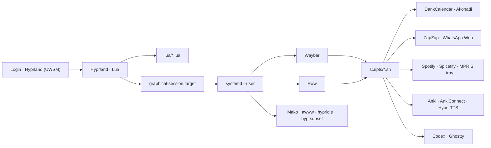

# Hyprland · openSUSE Tumbleweed

A reproducible Wayland desktop configured in Lua, with Catppuccin Mocha
styling and integrated calendar, music, study and terminal-writing workflows.

Supported target: **openSUSE Tumbleweed, amd64/x86_64, Hyprland 0.55+**.
The bootstrap backs up existing configuration before replacing known files.
Start with `--dry-run` to review its actions.

## What's included

| Area | Components and experience |
|---|---|
| Compositor | Hyprland 0.55+ in Lua, modular animations, rules and shortcuts |
| Session | UWSM and supervised `systemd --user` services |
| Interface | Waybar, Eww dashboard, Fuzzel, Mako, wlogout and Ghostty |
| Writing and files | Helix, Yazi, Marksman, Glow, Pandoc and optional Herdr |
| Appearance | Catppuccin Mocha, Kvantum, GTK, Papirus and Bibata |
| Calendar | DankCalendar for Google/Outlook; Proton Calendar on the web |
| Messaging | ZapZap with WhatsApp Web in Catppuccin Mocha/Peach |
| Music | Spotify with Spicetify, Marketplace, MPRIS and tray controls |
| Study | Anki, Study Hub, authenticated AnkiConnect and French audio |
| Local agents | Codex in Ghostty, with explicit sandbox and approval profiles |
| Utilities | Screenshots, recording, clipboard, OSD, VPN, media and monitors |

### Highlights

- **Terminal writing:** Helix keeps the existing coding configuration and adds
  Markdown support through Marksman. Yazi replaces nnn on `Super+E`. Herdr
  uses Mocha/Peach and forwards graphics previews. See the
  [writing, reading and citations quick reference](WORKFLOW.md).
- **Reactive dashboard:** Calendar, media, audio, brightness, clipboard, weather,
  telemetry and quick toggles in one Eww panel.
- **Useful status bar:** Privacy, recording, VPN, power profile, idle inhibitor
  and daily Study Hub workload.
- **Unified calendar:** Google and personal Outlook accounts in DankCalendar,
  with background synchronization and reminders; Proton stays in the browser.
- **Integrated WhatsApp:** User-scoped ZapZap Flatpak, dark mode and a
  Mocha/Peach theme applied through its native global CSS support.
- **Customizable music:** Spotify's Sleek/Catppuccin layout, visual Spicetify
  Marketplace, MPRIS and full tray controls.
- **Study Hub:** 60 curated notes and 84 cards about Kubernetes, NVIDIA/GPU on
  Kubernetes and French, without replacing existing collections.
- **French audio:** 24 cached MP3s, HyperTTS fallback and a silent diagnostic.
- **Scoped local agents:** Shortcuts for this configuration, calendar,
  selected projects and Anki, without disabling the sandbox.
- **Resilient docking:** The external monitor is identified by description;
  workspaces follow the single active display.

## Architecture



[`hyprland.lua`](hyprland.lua) is the canonical configuration. Active modules
live in [`lua/`](lua/); [`conf.d/`](conf.d/) remains a legacy reference and
rollback path.

## Installation

### 1. Get the repository

```bash
git clone https://github.com/thbertoldi/hypr-configs.git ~/hypr-bootstrap
cd ~/hypr-bootstrap
```

Alternatively, transfer the current bundle directly:

```bash
rsync -a ~/.config/hypr/ user@other-computer:~/hypr-bootstrap/
```

### 2. Review the plan

```bash
chmod +x bootstrap-opensuse-tumbleweed.sh
./bootstrap-opensuse-tumbleweed.sh --dry-run
```

### 3. Install

Run as your normal user; the installer requests `sudo` where needed.

```bash
./bootstrap-opensuse-tumbleweed.sh \
  --with-extras \
  --wallpaper ~/Pictures/my-wallpaper.jpg \
  --avatar ~/Pictures/my-avatar.jpeg
```

The bootstrap:

1. Checks for openSUSE Tumbleweed x86_64 and installs dependencies.
2. Installs DankCalendar, Spotify, ZapZap and Anki from Flathub where needed.
3. Downloads visual assets and Herdr/Marksman binaries with pinned SHA-256 hashes.
4. Backs up configuration under `~/.local/state/hypr-bootstrap/backups/`,
   including the **entire Helix directory**.
5. Deploys the UWSM session, settings, writing tools and user services.
6. Uses a safe generic monitor profile on different hardware.
7. Validates Bash, JSON, Hyprland, Helix and Herdr.

The goal is a **similar configured experience**, not an immutable OS snapshot:
distro packages follow Tumbleweed, and existing Herdr/Marksman binaries are
retained. Distributable app settings live in `portable/`; update those too
when a local customization should carry over to the next installation.
The complete installation bundle and guides remain in `~/.config/hypr/`.

At the next login, select **Hyprland (UWSM)** in the display manager.

### Bootstrap options

| Option | Effect |
|---|---|
| `--with-extras` | Also install the `wev` Wayland event inspector |
| `--same-hardware` | Keep this computer's LG ultrawide + `eDP-1` profile |
| `--internal-output eDP-2` | Replace the expected internal display name |
| `--wallpaper FILE` | Install the wallpaper used by awww |
| `--avatar FILE` | Install the Eww avatar |
| `--skip-packages` | Skip zypper and Herdr/Marksman installation; dependencies must already exist |
| `--skip-themes` | Skip font, cursor and theme downloads |
| `--dry-run` | Show actions without changing the machine |

## Monitors and portability

This machine's [`lua/monitors.lua`](lua/monitors.lua) implements a
**single-active-display** workflow:

- Docked: LG ultrawide at `3440x1440@85`, internal display off.
- Undocked: `monitor-listener.sh` re-enables the laptop display.
- Workspaces are not tied to a connector, so switching from `DP-1` to
  `HDMI-A-1` does not leave them stranded.

The LG is matched by its
[`desc:`](https://wiki.hypr.land/Configuring/Basics/Monitors/), not an unstable
connector name. On another computer, the bootstrap installs
[`portable/monitors-generic.lua`](portable/monitors-generic.lua), which uses
preferred modes and automatic positioning. Only use `--same-hardware` on a
genuinely equivalent machine.

After your first login:

```bash
hyprctl monitors
$EDITOR ~/.config/hypr/lua/monitors.lua
hyprctl reload
```

## Main shortcuts

| Shortcut | Action |
|---|---|
| `Super+Return` | Open Ghostty |
| `Super+E` | Open Yazi in Ghostty; text files open in Helix |
| `Super+D` | Open Fuzzel |
| `Super+W` | Toggle the Eww dashboard |
| `Super+O` | Open DankCalendar |
| `Super+M` | Open customized Spotify |
| `Super+G` | Open the agent menu |
| `Super+Shift+A` | Open the Anki Study Hub |
| `Super+Print` | Capture a region and annotate it with Swappy |
| `Super+Alt+R` | Start/stop recording a region |
| `Super+Shift+C` | Copy a color with Hyprpicker |
| `Super+Ctrl+M` | Configure monitors with NWG Displays |
| `Super+Ctrl+B` | Open btop in Ghostty |
| `Super+Escape` | Open the session menu |

`Print`, `Shift+Print` and `Ctrl+Print` keep the quick screenshot workflows.
Hardware audio/brightness keys update PipeWire/backlight and show the wob OSD.

## Calendar

[DankCalendar](https://github.com/AvengeMedia/dankcalendar) is the main calendar
interface. The Waybar clock, `Super+O` and Eww's **Agenda** button open a
floating window sized for the monitor. Eww gets upcoming events through the
local API.

Add accounts in the **Accounts** panel or from a terminal:

```bash
~/.config/hypr/scripts/dcal.sh account add google
~/.config/hypr/scripts/dcal.sh account add microsoft
```

- Google and personal Outlook use browser-based OAuth.
- Middle-clicking the clock also opens Outlook on the web.
- Proton Calendar opens exclusively on the web.
- Merkuro/KOrganizer and Akonadi remain available as fallbacks.

Tokens stay in KWallet and are not included in the repository.

## Messaging

[ZapZap](https://github.com/rafatosta/zapzap) replaces Whatsie as the main
WhatsApp client. The bootstrap installs the user-scoped Flatpak, requests dark
mode and injects static global CSS using the desktop's Catppuccin Mocha/Peach
colors. The versioned theme is in [`portable/zapzap/`](portable/zapzap/).

Open **ZapZap** through Fuzzel and complete its setup wizard. Sign in using the
official WhatsApp Web QR code. Whatsie is not automatically removed, so it can
remain a fallback until you have checked the migration.

Cookies, sessions, messages and downloads stay in ZapZap's private Flatpak
profile and are not versioned.

## Music

The official Spotify client supplies authentication, library access and
playback. [Spicetify](https://github.com/spicetify/cli) applies
**Sleek/Catppuccin** and adds a visual Marketplace for themes, snippets and
extensions. The user-scoped Flatpak makes customization reversible without
root access. A system-wide Spotify installation can coexist unchanged.

`Super+M` and Eww's **Spotify** button show a centered Wayland window without a
title bar, sized for the current monitor. `spotify-tray.service` supplies a
vector icon and a menu with the current track/artist, open, play/pause,
previous/next, shuffle, repeat and copy-track-link actions. The tray, dashboard,
`playerctl` and hardware keys all use MPRIS. A narrowly scoped Flatpak override
blocks only Spotify's redundant native tray indicator, leaving one icon without
affecting MPRIS.

The customization installer pins and verifies Spicetify 2.44.0, Marketplace
1.0.9 and both Sleek theme files using SHA-256. Spotify updates may require
rerunning `~/.config/hypr/scripts/spotify-customize.sh`. Login, library, history
and cache remain private to the Flatpak profile.

On a fresh installation, open Spotify, sign in and wait at least 60 seconds
before running `spotify-customize.sh`. This lets Spotify create the files
Spicetify expects. The bootstrap automatically applies customization to
already-authenticated profiles.

## Study Hub

Study Hub integrates [Anki](https://apps.ankiweb.net/) with Waybar, Eww, Fuzzel
and local agents:

| Deck | Notes | Cards |
|---|---:|---:|
| Kubernetes Core | 18 | 18 |
| NVIDIA GPUs on Kubernetes | 18 | 18 |
| French Essentials | 24 | 48 |
| **Total** | **60** | **84** |

Technical notes link to primary documentation. French sentences have
recognition and production cards with cached MP3s in Anki's media collection.
Seeding is idempotent and does not replace imported decks.

AnkiConnect:

- Listens only on `127.0.0.1:8765`.
- Requires a random key stored with `0600` permissions.
- Is installed from a reviewed release pinned by SHA-256.
- Never requires direct edits to Anki's SQLite database.

With Anki open, validate TTS, templates and media without playing audio:

```bash
~/.config/hypr/scripts/study-tts-check.sh
```

AnkiWeb login, collection, history and personal media are not versioned.

## Local agents

`Super+G` starts Codex in Ghostty with profiles for:

- Editing this configuration.
- Planning with the calendar.
- Creating or reviewing flashcards.
- Working in a selected folder.
- Inspecting the computer read-only.
- Resuming previous conversations.

Editing profiles use `workspace-write` and `on-request` approval. Bulk Anki
operations, template changes and deletion require explicit confirmation.
Run `codex login` before first use.

## Repository layout

```text
.
├── hyprland.lua                   # canonical compositor entry point
├── lua/                           # active Hyprland modules
├── conf.d/                        # legacy configuration / rollback
├── scripts/                       # desktop automation
├── portable/
│   ├── anki/                      # curated Study Hub bundle
│   ├── eww/                       # dashboard and listeners
│   ├── helix/                     # editor, languages and RPM-spec queries
│   ├── yazi/                      # Helix/Glow openers and Mocha/Peach theme
│   ├── herdr/                     # theme and graphics preview support
│   ├── silverbullet/              # optional theme recipe
│   ├── zapzap/                    # WhatsApp Web Mocha/Peach theme
│   ├── waybar/                    # bar and styles
│   ├── systemd/user/              # session services
│   └── ...                        # apps, themes and companion settings
├── assets/                        # optional local image instructions
├── docs/                          # historical design notes and plans
├── bootstrap-opensuse-tumbleweed.sh
├── WORKFLOW.md                    # Helix/Yazi/Herdr and citation reference
└── DECISIONS.md                   # history of incorporated improvements
```

## Verification and diagnostics

```bash
# Canonical configuration
Hyprland --verify-config --config ~/.config/hypr/hyprland.lua
hyprctl configerrors

# Scripts and data
for script in ~/.config/hypr/scripts/*.sh; do bash -n "$script"; done
jq empty ~/.config/hypr/portable/waybar/config.jsonc
jq empty ~/.config/hypr/portable/anki/starter-decks.json
hx --health markdown
hx --health rpmspec
herdr config check
yazi --debug

# Main services
systemctl --user status waybar eww mako hypridle

# Non-mutating installation preview
~/.config/hypr/bootstrap-opensuse-tumbleweed.sh --dry-run
```

## Deliberately unversioned data

- Calendar OAuth tokens, KWallet and account settings.
- Local AnkiConnect key.
- AnkiWeb login, collection and personal media.
- ZapZap login, sessions, messages and downloads.
- Spotify login, library, history and cache.
- Codex authentication and history.
- VPN profiles and credentials.
- Herdr sessions, SilverBullet spaces/credentials and Zotero databases.
- Dissertation texts and bibliographies; transfer your projects separately.
- Wallpaper, avatar and personal files.
- Optional binaries such as Handy and private smarty-pants settings.

See [`DECISIONS.md`](DECISIONS.md) for the history of improvements and security
decisions. Documentation is maintained in English; actual application labels
and language-learning content may use other languages.
